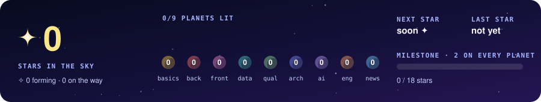

# ✦ Learning Sky

**A learning log. Every post becomes a star.**

<!-- SKY:START -->

<!-- SKY:END -->

I am relearning computing from the ground up. For each topic I write down what I learned, what I got wrong and what is still unclear.
Every post is published in **English** and **Türkçe**, with a small runnable example.
Posts are drafted with AI assistance and reviewed by me.

## 📚 Posts

<!-- POSTS:START -->
| Date | Topic | Title | Read |
| :-- | :-- | :-- | :-- |
| 2026-11-18 | Quality | How do you do a code review? What to look at, and in what order? | [🇬🇧 EN](posts/2026-11-18-code-review-nasil-yapilir/README.en.md) · [🇹🇷 TR](posts/2026-11-18-code-review-nasil-yapilir/README.tr.md) |
| 2026-11-18 | AI | How is AI changing a software developer's job? | [🇬🇧 EN](posts/2026-11-18-yapay-zeka-yazilimciyi-nasil-degistiriyor/README.en.md) · [🇹🇷 TR](posts/2026-11-18-yapay-zeka-yazilimciyi-nasil-degistiriyor/README.tr.md) |
| 2026-11-17 | Frontend | What is CORS? Why did the browser block my request? | [🇬🇧 EN](posts/2026-11-17-cors-nedir/README.en.md) · [🇹🇷 TR](posts/2026-11-17-cors-nedir/README.tr.md) |
| 2026-11-17 | Backend | What is idempotency? What happens if the same request arrives twice? | [🇬🇧 EN](posts/2026-11-17-idempotency-nedir/README.en.md) · [🇹🇷 TR](posts/2026-11-17-idempotency-nedir/README.tr.md) |
| 2026-11-16 | News | What did we learn from the big outages? CrowdStrike, AWS and Cloudflare | [🇬🇧 EN](posts/2026-11-16-buyuk-kesintilerden-dersler/README.en.md) · [🇹🇷 TR](posts/2026-11-16-buyuk-kesintilerden-dersler/README.tr.md) |
| 2026-11-16 | Basics | What is an exception? How should errors be handled? | [🇬🇧 EN](posts/2026-11-16-exception-nedir/README.en.md) · [🇹🇷 TR](posts/2026-11-16-exception-nedir/README.tr.md) |
| 2026-11-15 | News | How do you keep up with the software industry? My weekly reading routine | [🇬🇧 EN](posts/2026-11-15-sektor-nasil-takip-edilir/README.en.md) · [🇹🇷 TR](posts/2026-11-15-sektor-nasil-takip-edilir/README.tr.md) |
| 2026-11-15 | AI | What data should you never share with AI? Privacy, KVKK and company rules | [🇬🇧 EN](posts/2026-11-15-yapay-zekaya-hangi-veri-verilmez/README.en.md) · [🇹🇷 TR](posts/2026-11-15-yapay-zekaya-hangi-veri-verilmez/README.tr.md) |
| 2026-11-14 | Frontend | How does CSS work? The cascade, specificity, Flexbox and Grid | [🇬🇧 EN](posts/2026-11-14-css-nasil-calisir/README.en.md) · [🇹🇷 TR](posts/2026-11-14-css-nasil-calisir/README.tr.md) |
| 2026-11-14 | Quality | Why write tests? What is the test pyramid? | [🇬🇧 EN](posts/2026-11-14-test-piramidi/README.en.md) · [🇹🇷 TR](posts/2026-11-14-test-piramidi/README.tr.md) |
| 2026-11-13 | Backend | What is the client-server model? How are frontend and backend split? | [🇬🇧 EN](posts/2026-11-13-istemci-sunucu-modeli/README.en.md) · [🇹🇷 TR](posts/2026-11-13-istemci-sunucu-modeli/README.tr.md) |
| 2026-11-13 | Basics | What are JSON, YAML and XML? When to use which? | [🇬🇧 EN](posts/2026-11-13-json-yaml-xml/README.en.md) · [🇹🇷 TR](posts/2026-11-13-json-yaml-xml/README.tr.md) |
| 2026-11-12 | Architecture | How do you write an Architecture Decision Record (ADR)? | [🇬🇧 EN](posts/2026-11-12-adr-nasil-yazilir/README.en.md) · [🇹🇷 TR](posts/2026-11-12-adr-nasil-yazilir/README.tr.md) |
| 2026-11-12 | English | How do you write code review comments in English? Polite and clear patterns | [🇬🇧 EN](posts/2026-11-12-ingilizce-code-review-yorumlari/README.en.md) · [🇹🇷 TR](posts/2026-11-12-ingilizce-code-review-yorumlari/README.tr.md) |
| 2026-11-11 | Data | How does a database index work? When does it hurt? | [🇬🇧 EN](posts/2026-11-11-indeks-nasil-calisir/README.en.md) · [🇹🇷 TR](posts/2026-11-11-indeks-nasil-calisir/README.tr.md) |
| 2026-11-11 | English | How do you write a good commit message in English? | [🇬🇧 EN](posts/2026-11-11-ingilizce-commit-mesaji/README.en.md) · [🇹🇷 TR](posts/2026-11-11-ingilizce-commit-mesaji/README.tr.md) |
| 2026-11-10 | Data | What is a database? The relational model, tables and keys | [🇬🇧 EN](posts/2026-11-10-veritabani-nedir/README.en.md) · [🇹🇷 TR](posts/2026-11-10-veritabani-nedir/README.tr.md) |
| 2026-11-10 | Architecture | What is software architecture? Thinking in trade-offs | [🇬🇧 EN](posts/2026-11-10-yazilim-mimarisi/README.en.md) · [🇹🇷 TR](posts/2026-11-10-yazilim-mimarisi/README.tr.md) |
<!-- POSTS:END -->

## ✍️ Adding a new post (new star)

1. Copy `posts/_template` to a new folder named `YYYY-MM-DD-short-topic-name`.
2. Edit `meta.json`:
   - `status`: keep `"draft"` while writing. Drafts are invisible everywhere, so you can push unfinished work.
   - `date`, `topic` (one of the ids in `planets.json`), optional `series` + `seriesOrder`, `tags`.
   - `title`, `slug`, `summary` in both languages: `{"tr": "...", "en": "..."}`. A slug uses only `a-z`, `0-9` and `-`.
3. Write `README.en.md` and `README.tr.md`, and put the small runnable code in `example/`.
4. To publish, set `"status": "published"` and commit. A GitHub Action rebuilds the sky, the table above and `sky.json`,
   then tells the personal site to rebuild. A published post with a future `date` appears on that day.

Generated files, never edit by hand: `sky*.svg`, `topics/*.md`, `sky-embed.md`, `sky.json`.

## 🪐 Planets (topics)

Planets are defined in `planets.json`. Add a new object there to add a new topic.
Optional `"short"` is the short name under the planet on the star counter card (`sky-stats.svg`).

## 🧱 Post structure

1. What I researched this week and why
2. Three key takeaways
3. What I got wrong or still find unclear
4. Sources
