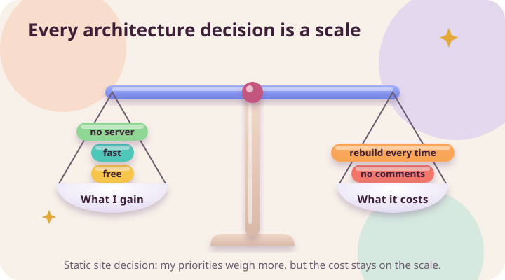

🇬🇧 **English** | [🇹🇷 Türkçe](README.tr.md)

# What is software architecture? Thinking in trade-offs

> *Researched and written by Zehra. Drafted with AI assistance and reviewed by me.*

**Short answer:** Software architecture is the set of important decisions about a system that are expensive to change later: how the system is split into parts, how those parts talk, where data lives, and which qualities (speed, security, maintainability) the system must be good at. None of these decisions are free. Every choice gains something and loses something. An architect's job is not to find "the best" option but to knowingly pick the least bad one for the situation, and to be able to explain why.

## 1. What I researched and why

My goal is to grow toward software architecture. Then I noticed I use the word "architecture" a lot without ever defining it. In my head it was always boxes and arrows: layers, microservices, diagrams.

There is also this: AI can now write a controller or an Angular component in seconds. As writing code gets cheaper, the question "which code, in which structure?" gets more expensive. The answer to that question is not in the code, it is in the context: how big is the team, how many users, is there a budget, what is lost if the system is down for five minutes? AI cannot know these things for me. So my first architecture post is about the question "what is architecture?"

## 2. Three key takeaways

1. **What separates architecture from design is the cost of change.** Renaming a method takes a minute: that is design. Changing the database, moving from a monolith to microservices or switching from an SPA to server-side rendering takes months: that is architecture. Grady Booch's definition says exactly this: architecture is the significant design decisions that shape a system, where significant is measured by the cost of change. So architecture is not a drawing, it is a set of decisions. The diagram is just a way to communicate them.

2. **Architecture has four parts, and "structure" is only one of them.** *Fundamentals of Software Architecture* splits it like this:
   - **Structure:** layered, monolith, modular monolith, microservices, event-driven...
   - **Architecture characteristics:** performance, scalability, availability, security, maintainability, testability, cost. Most end in "-ility", hence "the ilities".
   - **Architecture decisions:** rules, such as "the UI layer never talks to the database directly".
   - **Design principles:** guidance rather than rules, such as "prefer asynchronous communication between services".

   When I said "architecture" I only ever meant the first one. The real discussion is in the second: which quality actually matters for this project?

3. **Everything is a trade-off.** That is the book's "first law": everything in software architecture is a trade-off. The second law: why is more important than how. If someone says "X is always better", they either have not paid its price yet or they are selling something. The right answer is often "it depends", but that sentence alone is not an answer. The real question is: **depends on what?**

   A few familiar examples:
   - **Cache:** you gain speed, data can go stale, and now you have to decide when to invalidate it.
   - **Monolith vs microservices:** a monolith gives one deploy, easy debugging and simple transactions, but as it grows everyone collides in the same codebase. Microservices deploy and scale independently, but bring network failures, distributed transactions and a serious operational load. Usually too expensive for a team of three.
   - **Flexibility vs simplicity:** every abstraction added "because we might need it" makes code harder to read. Unneeded flexibility is not free (YAGNI: *You Aren't Gonna Need It*).

## 3. What I got wrong or still find unclear

- I thought architecture was the job of someone with "architect" in their title. In fact someone in every team makes these decisions, knowingly or not. A decision made without noticing is still a decision; its reasoning is just not written down.
- The line between architecture and design is still a bit blurry to me. "Cost of change" is a good measure, but it is hard to know upfront how expensive a decision will turn out to be. That seems to come with experience.
- How do I measure qualities? Saying "maintainability matters" is easy; turning it into a number is hard. I will come back to this in later posts (quality attributes, ADRs).

## 4. Example

The example for this post is not code, it is a real decision table from my own project. While building the Learning Sky site I made many architecture decisions without calling them that:

| Decision | Gains | Costs |
|---|---|---|
| Static site (Astro) + GitHub Pages | Free, very fast, no server, small attack surface | No server-side logic (comments or forms need an external service), rebuild on every change |
| Posts live in a separate repo, the site reads `sky.json` | Posts live independently of the site and are readable on GitHub, single source of data | The two repos must talk to each other (`repository_dispatch`), one more moving part |
| `sky.json` and the SVGs are generated, never hand-edited | No inconsistency, `meta.json` is the single source of truth | Even a tiny fix needs the generator to run |
| Planets are drawn in code with Three.js | Interactive, unique, no image files | Performance risk on weak phones, accessibility takes extra work |
| Astro instead of Angular | Natural fit for a content site, ships almost zero JavaScript by default | Not the framework I use at work, so it is something new to learn |

None of them is "right" or "wrong". My priorities (free, fast, impressive, posts independent) produced these decisions. If one day I want "readers can leave comments", the static site decision will push back and I will have to rethink it.

In [`example/`](example/) I tried the same idea as a small weighted decision matrix: a 30-line script that weights the qualities and scores the options.

**AI note:** If I ask "microservices or monolith for my project?", I get a confident answer with no context, and it usually leans toward whatever is popular. A better prompt: "The team is 3 people, we have this many users, the most important quality is this. Lay out the trade-offs of both options in a table and list the assumptions you are making separately." After I decide, I make it play devil's advocate: "What is the weakest point of this decision, and when will it hurt me?"

## 5. References

_Sources I used for this post. Links last accessed on 18 November 2026._

- Mark Richards, Neal Ford. *Fundamentals of Software Architecture*, 2nd edition, O'Reilly, 2025.
- Martin Fowler. "Software Architecture Guide". https://martinfowler.com/architecture/
- Grady Booch's definition of architecture, quoted in Fowler's guide and in "Who Needs an Architect?". https://martinfowler.com/ieeeSoftware/whoNeedsArchitect.pdf
- Fred Brooks. "No Silver Bullet" (1986), essential vs accidental complexity.
