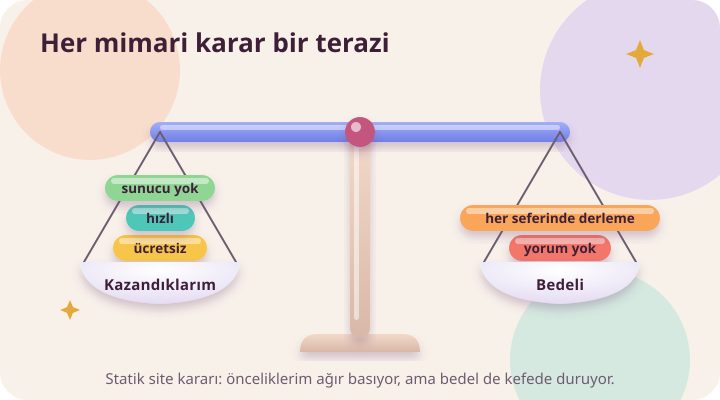

[🇬🇧 English](README.en.md) | 🇹🇷 **Türkçe**

# Yazılım mimarisi nedir? Trade-off düşüncesi

> *Zehra tarafından araştırıldı ve yazıldı. Yapay zekâ yardımıyla taslağı hazırlandı, ben gözden geçirdim.*

**Kısa cevap:** Yazılım mimarisi, bir sistemin sonradan değiştirmesi pahalı olan önemli kararlarının toplamıdır: sistem hangi parçalara bölünür, parçalar nasıl konuşur, veri nerede durur ve sistem hangi niteliklerde (hız, güvenlik, bakım kolaylığı) iyi olmak zorundadır. Bu kararların hiçbiri bedava değildir. Her seçim bir şey kazandırır, bir şey kaybettirir. Mimarın işi "en iyiyi" bulmak değil, o koşullarda en az kötü seçeneği bilerek seçmek ve nedenini anlatabilmektir.

## 1. Neyi araştırdım ve neden

Hedefim yazılım mimarisine doğru ilerlemek. Ama "mimari" kelimesini çok kullanıp tanımını hiç yapmadığımı fark ettim. Kafamda hep kutular ve oklar vardı: katmanlar, mikroservisler, diyagramlar.

Bir de şu var: yapay zekâ artık bir controller'ı ya da bir Angular component'ini saniyeler içinde yazıyor. Kod yazmak ucuzladıkça "hangi kodu, hangi yapıda yazacağız" sorusu pahalılaştı. Bu sorunun cevabı kodda değil, bağlamda: ekip kaç kişi, kullanıcı sayısı ne, bütçe var mı, sistem beş dakika çökse ne kaybedilir? Bunları yapay zekâ benim yerime bilemez. O yüzden ilk mimari yazımı "mimari nedir" sorusuna ayırdım.

## 2. Üç ana çıkarım

1. **Mimariyi tasarımdan ayıran şey değiştirme maliyeti.** Bir metodun adını değiştirmek bir dakika sürer, bu tasarımdır. Veritabanını değiştirmek, monolitten mikroservise geçmek ya da SPA'dan sunucu tarafı render'a dönmek aylar sürer, bu mimaridir. Grady Booch'un tanımı tam bunu söylüyor: mimari, sistemi biçimlendiren önemli tasarım kararlarıdır ve "önemli"nin ölçüsü değiştirmenin maliyetidir. Yani mimari bir çizim değil, bir karar kümesi. Diyagram sadece bu kararları anlatmanın yolu.

2. **Mimarinin dört parçası var, "yapı" bunlardan sadece biri.** *Fundamentals of Software Architecture* kitabı mimariyi şöyle ayırıyor:
   - **Yapı:** katmanlı, monolit, modüler monolit, mikroservis, olay güdümlü...
   - **Mimari nitelikler:** performans, ölçeklenebilirlik, ayakta kalma (availability), güvenlik, bakım kolaylığı, test edilebilirlik, maliyet. Çoğu İngilizcede "-ility" ile bittiği için "ilities" deniyor.
   - **Mimari kararlar:** kurallar. "UI katmanı veritabanına doğrudan gitmez" gibi.
   - **Tasarım ilkeleri:** kural değil, yön. "Servisler arasında mümkünse asenkron iletişim" gibi.

   Ben "mimari" deyince hep sadece birinciyi düşünüyormuşum. Oysa asıl tartışma ikincide: hangi nitelik bu proje için gerçekten önemli?

3. **Her şey bir trade-off.** Aynı kitabın "birinci kanunu" bu: yazılım mimarisinde her şey bir ödünleşimdir. İkinci kanunu da "nasıl"dan çok "neden" önemlidir. Biri "X her zaman daha iyidir" diyorsa ya bedelini henüz görmemiştir ya da bir şey satıyordur. Doğru cevap çoğu zaman "duruma göre değişir", ama bu cümle tek başına cevap sayılmaz. Asıl soru: **neye göre değişir?**

   Birkaç tanıdık örnek:
   - **Cache:** hız kazanırsın, veri bayatlayabilir ve "cache'i ne zaman temizleyeceğim" sorusu doğar.
   - **Monolit ve mikroservis:** monolitte tek deploy, kolay debug, basit transaction var ama büyüdükçe herkes aynı kodda çakışır. Mikroserviste parçalar bağımsız deploy edilir ve ölçeklenir ama ağ hataları, dağıtık transaction ve ciddi bir işletme yükü gelir. Üç kişilik bir ekip için genelde fazla pahalı.
   - **Esneklik ve basitlik:** "ileride lazım olur" diye eklenen her soyutlama okumayı zorlaştırır. Lazım olmayan esneklik bedava değil (YAGNI: *You Aren't Gonna Need It*).

## 3. Neyi yanlış anladım ya da hâlâ belirsiz

- Mimariyi bir şirkette "mimar" unvanlı birinin işi sanıyordum. Aslında her ekipte biri bu kararları veriyor, bilerek ya da bilmeyerek. Bilmeden verilen karar da bir karar, sadece gerekçesi yazılmamış.
- Mimari ile tasarım arasındaki çizgi hâlâ bana biraz bulanık. "Değiştirme maliyeti" iyi bir ölçü ama bir kararın ne kadar pahalı olacağını baştan bilmek zor. Bunu tecrübeyle öğreneceğim gibi görünüyor.
- Nitelikleri nasıl ölçeceğim? "Bakım kolaylığı önemli" demek kolay, bunu sayıya dökmek zor. Sonraki yazılarda (kalite nitelikleri, ADR) buna döneceğim.

## 4. Örnek

Bu yazının örneği kod değil, kendi projemden gerçek bir karar tablosu. Learning Sky sitesini kurarken farkında olmadan bir sürü mimari karar verdim:

| Karar | Kazandırdığı | Kaybettirdiği |
|---|---|---|
| Statik site (Astro) + GitHub Pages | Ücretsiz, çok hızlı, sunucu yok, saldırı yüzeyi küçük | Sunucu tarafı mantık yok (yorum, form için dış servis gerekir), her değişiklikte yeniden derleme |
| Yazılar ayrı repoda, site `sky.json`'u okuyor | Yazılar siteden bağımsız yaşar, GitHub'da da okunur, tek veri kaynağı | İki repo arası haberleşme gerekir (`repository_dispatch`), bir parça daha hareketli |
| `sky.json` ve SVG'ler üretiliyor, elle düzenlenmiyor | Tutarsızlık olmaz, tek doğruluk kaynağı `meta.json` | Küçük bir düzeltme için bile üreticiyi çalıştırmak gerekir |
| Gezegenler Three.js ile kodla çiziliyor | Etkileşimli, benzersiz, resim dosyası yok | Zayıf telefonda performans riski, erişilebilirlik ek emek ister |
| Angular yerine Astro | İçerik sitesi için doğal, neredeyse sıfır JavaScript ile başlıyor | İşte kullandığım framework değil, yeni bir şey öğreniyorum |

Hiçbiri "doğru" ya da "yanlış" değil. Önceliklerim (ücretsiz, hızlı, etkileyici, yazılar bağımsız) bu kararları doğurdu. Bir gün "okurlar yorum yazabilsin" dersem, statik site kararı beni zorlayacak ve yeniden düşünmem gerekecek.

[`example/`](example/) klasöründe aynı mantığı küçük bir ağırlıklı karar matrisiyle denedim: nitelikleri ağırlıklandırıp seçenekleri puanlayan 30 satırlık bir script.

**Yapay zekâ notu:** "Projem için mikroservis mi monolit mi?" diye sorarsam bağlamı bilmeden kendinden emin bir cevap alıyorum ve cevap genelde popüler olana kayıyor. Daha iyi soru: "Ekip 3 kişi, şu kadar kullanıcı var, en önemli nitelik şu. İki seçeneğin trade-off'larını tablo halinde çıkar ve hangi varsayımlarla konuştuğunu ayrıca yaz." Kararımı verdikten sonra da onu şeytanın avukatı yapıyorum: "Bu kararın en zayıf yeri ne, hangi durumda beni yakar?"

## 5. Kaynakça

_Bu yazıda yararlandığım kaynaklar. Bağlantılara son erişim: 18 Kasım 2026._

- Mark Richards, Neal Ford. *Fundamentals of Software Architecture*, 2. baskı, O'Reilly, 2025.
- Martin Fowler. "Software Architecture Guide". https://martinfowler.com/architecture/
- Grady Booch'un mimari tanımı, Fowler'ın rehberinde ve "Who Needs an Architect?" yazısında aktarılıyor. https://martinfowler.com/ieeeSoftware/whoNeedsArchitect.pdf
- Fred Brooks. "No Silver Bullet" (1986), esas ve araz karmaşıklık ayrımı.

---

© 2026 Zehra Betül Çuhadar. Bu yazının metni ve görselleri [CC BY-NC-ND 4.0](https://creativecommons.org/licenses/by-nc-nd/4.0/deed.tr) lisanslıdır: adımı ve bağlantıyı vererek, ticari olmayan amaçla ve değiştirmeden paylaşabilirsin. Kod örnekleri için tüm hakları saklıdır, bkz. [LICENSE-CODE](../../LICENSE-CODE).
